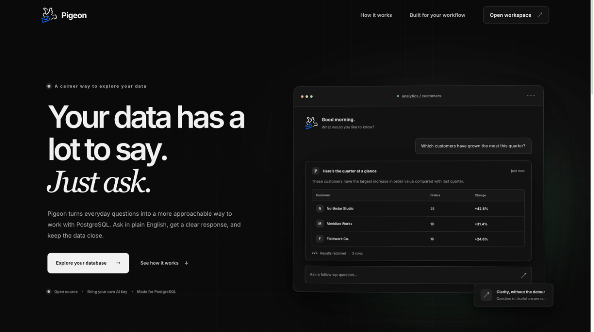

# 🐦 Pigeon


**Talk to your Postgres database in plain English. Open source. Bring your own AI key.**

Pigeon is a free, self-hostable alternative to paid "chat with your database" tools. Ask questions in natural language — get real SQL, real data, and real answers. Powered by whatever LLM you want to plug in.


**Try it live:** [pigeon-unht.onrender.com](https://pigeon-unht.onrender.com)
## Why Pigeon?

Most "chat with your database" tools charge $20–$200/month and lock you into their LLM. Pigeon is different:

- **Free forever.** No subscription. No credit card. MIT licensed.
- **Bring your own key.** Use OpenAI, OpenRouter, Google Gemini, or Anthropic.
- **Bring your own database.** Connect to supported public PostgreSQL endpoints when using the hosted service; self-hosters can opt in to local/private databases.
- **Read-only queries.** Query parsing and PostgreSQL read-only transactions reject writes.
- **You see the SQL.** Every answer shows the exact query that was executed.

## Features

-  Natural language questions → real SQL
-  Read-only PostgreSQL transactions and parsed single-`SELECT` validation
-  Multi-provider: OpenAI, OpenRouter, Google Gemini, Anthropic
-  Multi-conversation sidebar (like ChatGPT)
-  Results rendered as tables in the chat
-  Database connection, statement, response-size, and request-rate limits
-  Warm, minimal UI — not another dark-mode dashboard
-  Zero-cost AI usage — you pay your provider directly

## Quick start

### 1. Clone and install

```bash
git clone https://github.com/Harilol/pigeon.git
cd pigeon
python -m venv .venv
source .venv/bin/activate    # On Windows: .venv\Scripts\activate
pip install -r requirements.txt
```

### 2. Configure

```bash
cp .env.example .env
```

Generate a local Django secret and replace the example `SECRET_KEY` (for example, `python -c "from django.core.management.utils import get_random_secret_key; print(get_random_secret_key())"`). Users provide their own AI provider key in the app; the server does not use or fall back to a server-owned provider key.

### 3. Run

```bash
python manage.py migrate
python manage.py runserver
```

Open [http://127.0.0.1:8000](http://127.0.0.1:8000).

### 4. Use

1. Click **Get started**.
2. Enter your Postgres credentials. Click **Connect Database**.
3. In **AI Settings**, pick a supported provider, paste your API key, and enter a model name that supports **tool calling**.
4. Ask questions in the chat.

## ⚠️ Model selection matters

**Free and small models are unreliable at tool calling.** You may see raw XML like `<tool_call>` in the chat instead of a proper answer. This isn't a bug in Pigeon — it's a limitation of the model itself. Some models work; some don't.

**For the best experience, use one of these models:**

| Provider | Model | Why |
|---|---|---|
| **OpenAI** | `gpt-4o-mini` | Fast, reliable tool calling |
| **OpenRouter** | `openai/gpt-4o-mini` | Unified access to supported models |
| **Google Gemini** | `gemini-2.5-flash` | Fast tool-capable model |
| **Anthropic** | `claude-haiku-4-5` | Fast Claude model |

**Avoid:** Models labeled "mini-free", "flash-lite", "reasoner", or anything with "preview" in the name. These usually don't support structured tool calling properly.

**How to check if a model supports tools:**
- [OpenRouter — tool-capable models](https://openrouter.ai/models?supported_parameters=tools)
- [OpenAI — function calling docs](https://platform.openai.com/docs/guides/function-calling)

## How it works

```
Browser ──> Django ──> AI provider (with tool: run_sql)
                 │
                 └──> Postgres (SELECT only)
```

1. The browser sends the user's provider key, database connection details, and question to Django for that request.
2. Django resolves and checks the database host, then reads the schema using a read-only PostgreSQL connection.
3. The schema and question are sent to the selected, allowlisted AI provider.
4. If the AI requests a query, Django parses it as one `SELECT` and executes it in a read-only transaction with connection, lock, and statement timeouts.
5. Results are limited to 100 rows, 100 columns, and a bounded response size before being returned to the browser.

## Guardrails

- Requests are throttled per client IP (10 connection checks and 6 chat requests per minute by default). These limits protect the hosted service and do not limit the user's AI provider credits.
- Public deployments reject database hosts that resolve to private, loopback, or other non-public IP addresses to prevent the service being used to reach internal networks. Self-hosters can explicitly enable private targets.
- The AI key is required on every chat request. The server never uses a fallback key, and clients cannot choose an arbitrary AI URL; only the providers configured in the backend are accepted.
- The database host is resolved and pinned to a checked address for each connection, with TLS required by default in production.
- SQL is parsed as one PostgreSQL `SELECT`, write statements nested in a CTE are rejected, and known dangerous functions (filesystem, sequence mutation, network, and backend-control functions) are blocked. Queries run in a PostgreSQL read-only transaction with a 5-second statement timeout, a 1.5-second lock timeout, and a 5-second connection timeout.
- Results are capped at 100 rows, 100 columns, 1,024 characters per cell, and 512 KB total.
- Credentials are sent to the Pigeon backend while handling a request and are not persisted by the backend. The user's AI provider receives the question, schema, and query results. The browser may store connection and AI settings in local storage.

Use a dedicated PostgreSQL role with only the minimum read privileges required. Do not connect as a database superuser: PostgreSQL read-only transactions prevent ordinary writes, but cannot make every installed database function side-effect-free.

## Production deployment

The backend is intentionally fail-closed in production. Set these environment variables before starting it:

- `DEBUG=False`
- `SECRET_KEY` — a fresh, random Django secret; do not reuse the development value.
- `ALLOWED_HOSTS` — comma-separated backend hostnames, without schemes.
- `CORS_ALLOWED_ORIGINS` — comma-separated exact frontend origins, including `https://`.
- `DATABASE_URL` — a persistent Django-owned database for Django's internal state.
- `REDIS_URL` — a Redis URL for rate limits shared by all workers.
- `TRUSTED_PROXY_COUNT` — the number of trusted forwarding-proxy entries used to derive client IPs. Configure this for the hosting provider; do not trust forwarded headers when the app is directly exposed.
- Frontend build variable `VITE_API_BASE_URL` — the backend's public HTTPS origin (for example, `https://api.example.com`). Set `CORS_ALLOWED_ORIGINS` to the frontend's HTTPS origin.

For a public deployment, leave `ALLOW_PRIVATE_DATABASE_HOSTS` unset or set it to `False`, and leave `DATABASE_SSLMODE` at `require`. Provision Redis and a persistent database before deploying; startup fails if these production dependencies or required origins/secrets are missing. Run migrations as a release/deploy step and serve the app with Gunicorn, for example:

```bash
python manage.py migrate
gunicorn config.wsgi:application --workers 2 --timeout 75 --access-logfile - --error-logfile -
```

The request limits can be adjusted with `CONNECT_REQUESTS_PER_MINUTE` and `ASK_REQUESTS_PER_MINUTE`. If Redis is unavailable, the API fails closed rather than silently disabling throttling.

## Tech stack

- **Django** — backend
- **psycopg2** — Postgres driver
- **OpenAI SDK** — universal LLM client (works with any OpenAI-compatible provider)
- **Vanilla JS** — no build step, no framework
- **localStorage** — conversations and settings are saved in the browser; credentials are also sent to the backend for requests

## Project structure

```
pigeon/
├── config/           # Django project settings
├── core/
│   ├── templates/
│   │   ├── landing.html
│   │   └── connect.html
│   ├── views.py      # connect_page, landing_page, ask_ai
│   └── urls.py
├── docs/
│   └── screenshot.png
├── manage.py
├── requirements.txt
└── README.md
```

## Roadmap

- [ ] CSV export on result tables
- [ ] Mobile responsive layout
- [ ] Query explanation mode (AI explains the SQL)
- [ ] Schema browser sidebar
- [ ] Support for MySQL / SQLite
- [ ] Docker one-command setup

## Contributing

Pull requests welcome. For major changes, open an issue first.

## Author

Built by [@Harilol](https://github.com/Harilol).

If you find Pigeon useful, ⭐ the repo and share it.

## License

MIT — see [LICENSE](LICENSE).
